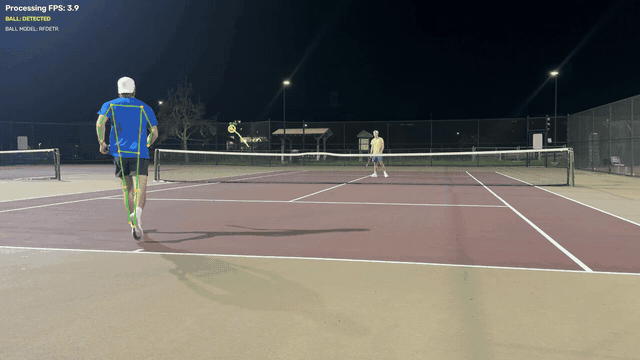
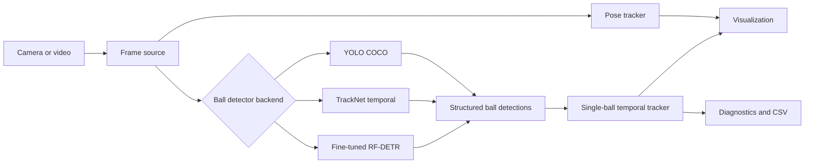

# Tennis Vision


Tennis Vision is an incremental computer-vision system for analyzing tennis
footage. It currently combines human pose estimation with three interchangeable
ball-localization backends, source-aware temporal tracking, diagnostics, and a
reviewed-data RF-DETR training workflow.

The project is intentionally measurement-first. It preserves raw detections,
reports what was actually validated, and does not calculate physical ball speed
or biomechanics until camera geometry and detection accuracy can support those
claims.

> **Research status:** the custom RF-DETR model has promising same-recording
> results, but it has not passed a new-session generalization test or final visual
> validation. It is not yet established as the primary detector.

## Demo

[](https://github.com/kamhyles/tennis-vision/issues/1)

*The inline preview is optimized for fast README loading. Click it to open the
full 27-second, 1080p60 H.264 demo in GitHub's video player. The
[original MP4 is also available for download](https://github.com/kamhyles/tennis-vision/releases/download/demo-v0.3b/tennis-vision-demo-1080p60.mp4).*

This run combines YOLO11n pose tracking with the fine-tuned RF-DETR ball detector
and the image-space trajectory overlay. It was processed offline and exported at
normal playback speed; the on-screen **Processing FPS** value reports inference
throughput, not video playback speed.

The footage comes from the same recording used to develop the initial dataset, so
it demonstrates the current pipeline but does not establish new-session accuracy.

## What works today

- YOLO11n Pose tracking with a compact 17-keypoint skeleton overlay
- Webcam and prerecorded-video input with source frame indices and timestamps
- Three selectable tennis-ball backends:
  - **YOLO:** generic COCO `sports ball` baseline
  - **TrackNet:** three-frame temporal tennis detector
  - **RF-DETR:** custom one-class detector trained on reviewed `tennis ball` boxes
- Explainable single-ball tracking with motion gating and short missed-frame
  prediction
- Raw bounding boxes, centers, confidence, trails, and detector labels
- Independent pose and ball inference cadences for high-frame-rate video
- Per-stage timing, continuity diagnostics, and optional per-frame CSV output
- Timestamp-preserving, normal-speed H.264 export for offline analysis
- Leakage-resistant dataset generation, validation, training, and evaluation tools
- 55 automated tests covering pose, media timing, detectors, tracking, datasets,
  RF-DETR conversion, and localization metrics

## Current experimental findings

| Backend | What has been observed | Current role |
|---|---|---|
| YOLO11n COCO | Detects stationary and slowly moving tennis balls, but frequently loses faster motion | Preserved baseline |
| TrackNet V1 | Detects the fast-moving ball substantially better than generic YOLO, but raw centers visibly jitter | Temporal baseline |
| Fine-tuned RF-DETR Small | Strong same-recording box metrics and sub-pixel median center error, with several consequential outliers and duplicate candidates | Experimental precision detector |

The RF-DETR test split contains 33 annotated frames from a temporally separated
section of the same source recording:

| Metric | Result |
|---|---:|
| COCO mAP@50:95 | 0.534 |
| COCO mAP@50 | 0.924 |
| COCO mAP@75 | 0.653 |
| COCO precision / recall | 1.000 / 0.879 |
| Raw annotated-frame detection rate at confidence 0.25 | 33 / 33 |
| Median center error | 0.57 px |
| P90 center error | 1.42 px |
| Mean center error | 21.16 px |
| Median IoU | 0.802 |
| Extra detections on annotated images | 17 |
| 1024px MPS inference | 3.51 FPS |

The large gap between median and mean center error is important: roughly 91% of
matched centers were within 5 px, while a small number of severe candidate
selection failures dominated the mean. The test split has no negative images, so
its false-positive rate on ball-absent frames is still unknown.

**This dataset originates from one recording and is not sufficient evidence of
cross-session generalization.**

## Architecture



The detector boundary keeps model-specific inference separate from tracking and
rendering. Every direct ball detection can retain its source-space box, center,
confidence, frame index, timestamp, and detector identity. Pose data and raw
measurements remain accessible independently of the display overlay.

### Ball tracking strategy

The current tracker is deliberately simple and explainable:

1. When no track exists, acquire the highest-confidence candidate.
2. Predict the next image-space position using recent constant velocity.
3. Select the closest candidate inside a time-scaled movement gate.
4. Predict through a small configurable number of missed detections.
5. Clear the track after a prolonged miss and allow fresh acquisition.

Direct RF-DETR coordinates are not smoothed. That preserves the raw localization
behavior needed for an honest comparison with TrackNet.

## Project layout

```text
tennis_vision/
├── main.py                         # CLI entry point
├── tennis_vision/
│   ├── app.py                      # Application orchestration
│   ├── config.py                   # Typed configuration
│   ├── media.py                    # Camera/video timing and frames
│   ├── vision/                     # Pose, YOLO, TrackNet, RF-DETR
│   ├── tracking/                   # Model-independent ball tracking
│   ├── dataset/                    # Candidate generation and COCO validation
│   └── evaluation/                 # Center-localization metrics
├── tools/                          # Dataset, training, evaluation, benchmarks
├── configs/rfdetr/                 # Reproducible RF-DETR baseline config
├── scripts/                        # Verified model-download helpers
├── tests/                          # Non-camera automated tests
└── docs/                           # Dataset and RF-DETR experiment details
```

Videos, reviewed datasets, virtual environments, model weights, outputs, and
training checkpoints are intentionally excluded from Git.

## Quick start

### 1. Install the core environment

Python 3.10 or newer is recommended.

```bash
git clone https://github.com/kamhyles/tennis-vision.git
cd tennis-vision

python3 -m venv .venv
source .venv/bin/activate
python -m pip install --upgrade pip
python -m pip install -r requirements.txt
```

The first YOLO run downloads `yolo11n-pose.pt` and `yolo11n.pt`. These weight
files are ignored by Git.

### 2. Run the application

Webcam with the generic YOLO ball baseline:

```bash
python main.py
```

Prerecorded video:

```bash
python main.py --video videos/your-tennis-video.mp4
```

Useful controls:

- Press `q` in the OpenCV window to stop.
- Use `--max-frames 120` for a short experiment.
- Use `--pose-every N` and `--ball-every N` to control inference cadence.
- Use `--detections-output outputs/run.csv` for per-frame results.
- Run `python main.py --help` for every option.

### Export a normal-speed annotated video

Offline inference may take much longer than the source video, but the exporter
uses source timestamps so the finished MP4 plays at normal speed. FFmpeg must be
available on `PATH`; on macOS it can be installed with `brew install ffmpeg`.

```bash
source .venv-rfdetr/bin/activate

python main.py \
  --video videos/IMG_8356.MOV \
  --ball-detector rfdetr \
  --device mps \
  --pose-every 8 \
  --output-video outputs/annotated-demo.mp4 \
  --no-preview
```

The default export ceiling is 60 FPS for browser compatibility. Use
`--output-fps 30` for a smaller demo or `--output-fps 120` to retain the source's
full temporal rate. Exported MP4s are video-only, and the command refuses to
overwrite an existing output file.

## Ball detector backends

### YOLO baseline

```bash
python main.py \
  --video videos/your-tennis-video.mp4 \
  --ball-detector yolo
```

This restricts generic YOLO11n detection to COCO class 32, `sports ball`. It is
useful as a baseline but is physically confirmed to be unreliable for fast,
small tennis balls.

### TrackNet temporal baseline

Download and checksum-verify the tennis TrackNet checkpoint:

```bash
python scripts/download_tracknet_weights.py
```

Then run:

```bash
python main.py \
  --video videos/your-tennis-video.mp4 \
  --ball-detector tracknet \
  --ball-every 1 \
  --device mps
```

TrackNet requires every source frame because it consumes three consecutive frames.
Pose inference may still run less often, for example with `--pose-every 8`.

### Fine-tuned RF-DETR

RF-DETR uses an isolated environment because its training stack is substantially
larger than the core application dependencies:

```bash
python3 -m venv .venv-rfdetr
source .venv-rfdetr/bin/activate
python -m pip install --upgrade pip
python -m pip install -r requirements-rfdetr.txt
```

Run a locally trained checkpoint:

```bash
python main.py \
  --video videos/your-tennis-video.mp4 \
  --ball-detector rfdetr \
  --rfdetr-checkpoint runs/rfdetr/tennis_ball_small_1024/checkpoint_best_total.pth \
  --rfdetr-input-size 1024 \
  --device mps
```

The 126 MB fine-tuned checkpoint is not stored in this repository. Reproduce it
with the workflow below or provide your own compatible checkpoint.

## How the tennis-ball dataset was built

The first real dataset came from one 1920×1080, approximately 120 FPS tennis
recording containing 3,296 source frames.

1. TrackNet scanned the full source video.
2. The generator sampled temporally spaced and spatially varied candidates.
3. It produced 236 full-resolution images: 199 TrackNet prelabels and 37
   TrackNet-miss review candidates.
4. Astra Boxes generated tight ball boxes in Roboflow.
5. A human reviewed the annotations; 235 images were approved.
6. The reviewed export was validated for class names, references, dimensions,
   bounds, box area, duplicates, and missing files.
7. Source-frame tokens in filenames reconstructed leakage-resistant temporal
   train, validation, and test regions with one-second guard gaps.

TrackNet prelabels were used only to accelerate review. They were **not** used as
training ground truth.

### Reviewed data summary

- Exact authoritative class: `tennis ball`
- 235 reviewed images and 234 positive boxes
- One reviewed zero-annotation image
- Median source box: 12×12 px
- Median box area: 143 px², or 0.0069% of a source frame
- Temporal split: 175 train / 27 validation / 33 test

Generate candidates:

```bash
python tools/build_ball_dataset.py \
  --videos videos/ \
  --output datasets/tennis_ball_v1 \
  --target-frames 300 \
  --device mps
```

Validate and split a reviewed Roboflow COCO export:

```bash
python tools/prepare_reviewed_ball_dataset.py \
  --source "Tennis Ball Detection.coco" \
  --output datasets/tennis_ball_reviewed_temporal
```

See [docs/BALL_DATASET.md](docs/BALL_DATASET.md) for candidate generation and
[docs/RFDETR_EXPERIMENT.md](docs/RFDETR_EXPERIMENT.md) for the reviewed-data audit.

## RF-DETR training and evaluation

The reproducible baseline is RF-DETR Small initialized from the official
`rf-detr-small.pth` checkpoint and fine-tuned at 1024×1024:

```bash
source .venv-rfdetr/bin/activate

python tools/train_rfdetr_ball.py --check-only
python tools/train_rfdetr_ball.py

python tools/evaluate_rfdetr_ball.py \
  --checkpoint runs/rfdetr/tennis_ball_small_1024/checkpoint_best_total.pth \
  --device mps \
  --output runs/rfdetr/tennis_ball_small_1024/test_metrics.json
```

The completed Apple MPS run used a physical batch of 1, four-step gradient
accumulation, AdamW, EMA, conservative augmentation, and early stopping. It
validated epochs 0–16, selected the EMA checkpoint from epoch 6, and took about
57 minutes. The full configuration is in
[configs/rfdetr/tennis_ball_small_1024.json](configs/rfdetr/tennis_ball_small_1024.json).

Compare backend throughput and continuity on the same footage:

```bash
python tools/benchmark_ball_backends.py \
  --video videos/your-tennis-video.mp4 \
  --backend yolo \
  --backend tracknet \
  --backend rfdetr \
  --rfdetr-checkpoint runs/rfdetr/tennis_ball_small_1024/checkpoint_best_total.pth \
  --device mps \
  --max-frames 300
```

Operational continuity counts are not accuracy metrics. Ground-truth evaluation
and raw visual inspection remain separate requirements.

## Tests

Run the complete non-camera suite:

```bash
python -m unittest discover -s tests -v
```

Current result: **52 tests passed**.

## Known limitations

- All reviewed RF-DETR images originate from one short recording.
- The same-recording test split cannot demonstrate new-session generalization.
- The RF-DETR test split contains no negative frames.
- A few RF-DETR candidate-selection failures produce large center-error outliers.
- RF-DETR at 1024px runs at roughly 3.5 FPS on the tested Apple MPS setup.
- TrackNet localization is temporally effective but visibly jittery.
- Current tracking is image-space only; it is not physical trajectory estimation.
- Court calibration, ball velocity, racket tracking, contact detection,
  biomechanics, and coaching are intentionally future milestones.

## Development principles

- Validate each subsystem before adding the next.
- Preserve raw inference output independently of visualization.
- Prefer measurement accuracy and temporal stability over feature count.
- Handle missing detections explicitly.
- Never fabricate physical measurements unsupported by the camera data.
- Distinguish automated, same-recording, and physical validation.

See [PROGRESS.md](PROGRESS.md) for the detailed experimental record and
[AGENTS.md](AGENTS.md) for project engineering constraints.

## Third-party models and licensing

Model weights are not committed. RF-DETR Small uses Apache-2.0-licensed core
weights; Ultralytics and the TrackNet implementation have separate terms and
provenance. Review [THIRD_PARTY.md](THIRD_PARTY.md) before redistributing weights
or deploying commercially.

No project-wide source license has been declared yet.
